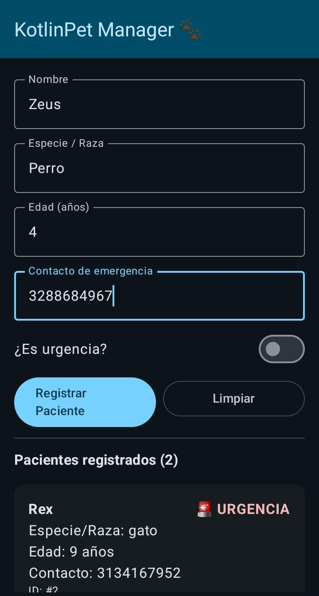
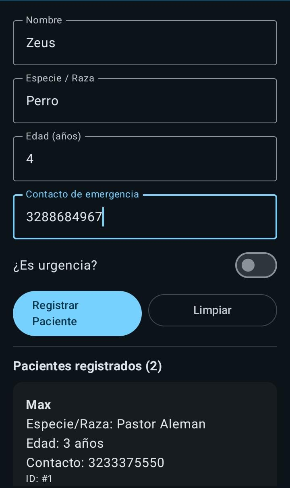
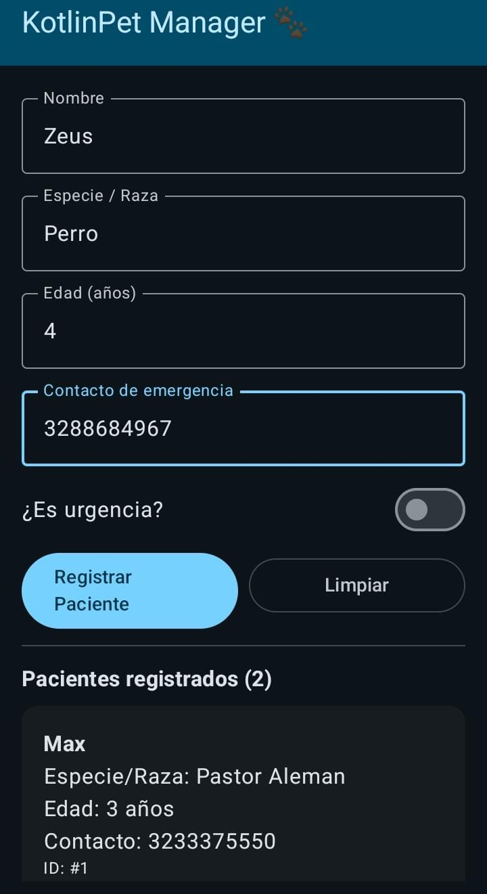
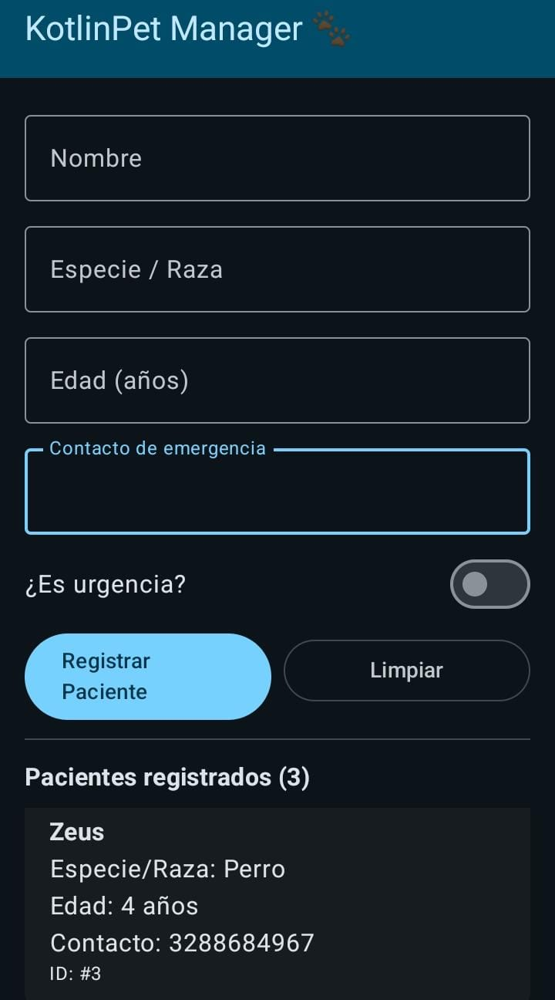
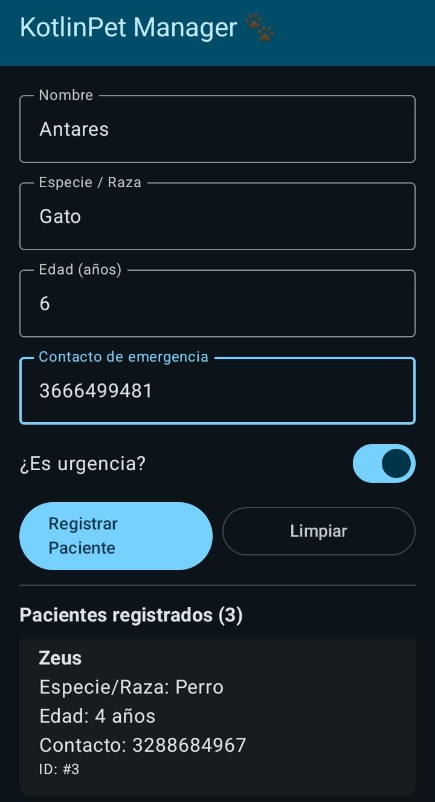
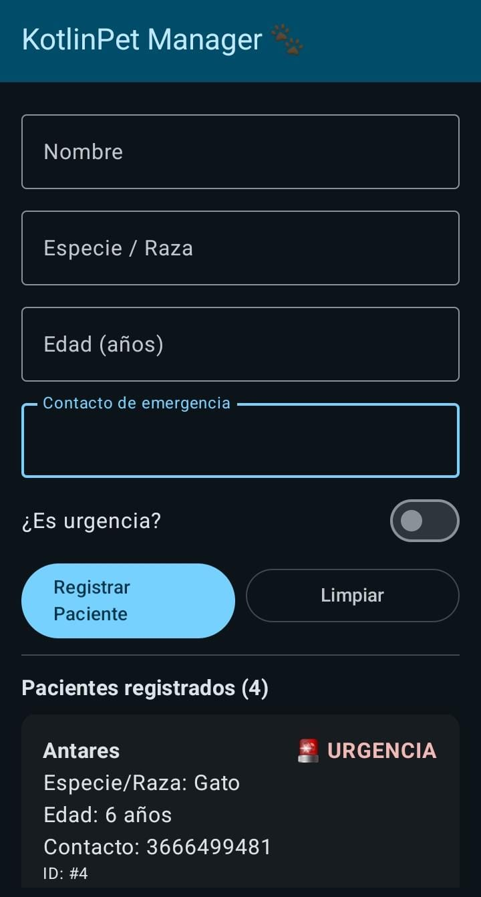

# KotlinPet Manager 🐾

Aplicación Android para registrar los pacientes de una clínica veterinaria. 

Proyecto del curso de Desarrollo de Aplicativos Móviles

Universidad Tecnológica de Pereira.

**Autor:** Juan Pablo Restrepo Parra

**Código:** 1107838966

**Correo:** juan.restrepo11@utp.edu.co

---

## Sobre la aplicación

En una sola pantalla se llena un formulario con los datos de la mascota y, al presionar **Registrar Paciente**, aparece de inmediato en una lista justo debajo. Cada paciente se muestra en su propia tarjeta y, si se marcó como urgencia, la tarjeta lo indica en rojo para que no pase desapercibido.

Los datos que se piden son:

- Nombre
- Especie o raza
- Edad (en años)
- Contacto de emergencia
- Si es o no una urgencia

## Qué se puede hacer

- Registrar pacientes y verlos en la lista al instante.
- Marcar un caso como urgente con un interruptor.
- Limpiar el formulario con un botón.
- Ver cuántos pacientes van registrados.

La app también revisa los datos antes de guardarlos. Si falta algún campo o la edad no es un número entero, muestra un mensaje de error y no registra nada, en lugar de cerrarse.

## Cómo está organizado el código

Usé la arquitectura **MVVM**, que separa la aplicación en tres partes:

| Capa | Archivo | Qué hace |
|---|---|---|
| Model | `model/Paciente.kt` | Define cómo es un paciente (sus datos y tipos). |
| ViewModel | `viewmodel/PacienteViewModel.kt` | Guarda la lista y lo que se escribe en el formulario, valida y registra. |
| View | `view/PacienteScreen.kt` | Dibuja la pantalla con Jetpack Compose y Material 3. |

~~~
app/src/main/java/com/utp/kotlinpetmanager/
├── model/
│   └── Paciente.kt
├── viewmodel/
│   └── PacienteViewModel.kt
├── view/
│   └── PacienteScreen.kt
├── ui/theme/
└── MainActivity.kt
~~~

La pantalla no guarda ni modifica datos por su cuenta. Cuando el usuario escribe o presiona un botón, la vista le avisa al ViewModel, y este actualiza el estado. Como ese estado es observable (`mutableStateOf`), la pantalla se redibuja sola con los cambios. Además, las variables del ViewModel tienen `private set`, así que solo él puede modificarlas.

La interfaz usa `Scaffold` con `TopAppBar`, una `Column` para el formulario, campos `OutlinedTextField`, `Row` para el interruptor y los botones, y una `LazyColumn` con `ElevatedCard` para la lista de pacientes.

## Algunas decisiones sobre los datos

~~~kotlin
data class Paciente(
    val id: Int,
    val nombre: String,
    val especie: String,
    val edad: Int,
    val contactoEmergencia: String,
    val esUrgencia: Boolean
)
~~~

- **El contacto es `String`, no `Int`.** Un celular de 10 dígitos no cabe en un `Int` (el máximo es 2 147 483 647) y, de todas formas, con un teléfono no se hacen cuentas.
- **La edad llega como texto y se convierte a `Int` al registrar.** Los campos de texto siempre devuelven un `String`, así que uso `toIntOrNull()`. Si alguien escribe algo que no es un número, la función devuelve `null` y la app muestra el error en vez de fallar.

## Capturas

Probada en un Samsung Galaxy A01.

  

  

## Cómo ejecutarla

1. Clonar el repositorio:
   ~~~
   git clone https://github.com/juanrestrepo11-coder/KotlinPetManager.git
   ~~~
2. Abrir la carpeta en Android Studio y esperar a que Gradle sincronice.
3. Correrla en un emulador o en un celular con Android 7.0 o superior.

## Comentarios finales

Lo que más me sirvió de este proyecto fue entender para qué se separa el código en capas. Al principio parecía más trabajo tener tres archivos para algo tan pequeño, pero al final resultó más fácil saber dónde estaba cada cosa y qué debía cambiar cuando algo no funcionaba. También me pareció muy práctico que la pantalla se actualice sola cuando cambia el estado, sin tener que estar refrescándola a mano.